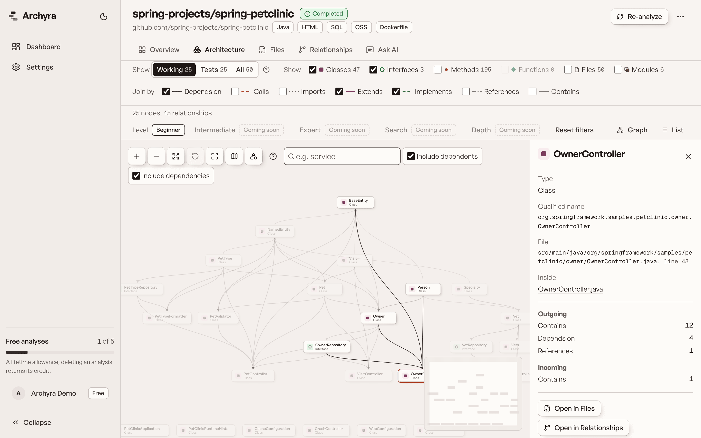
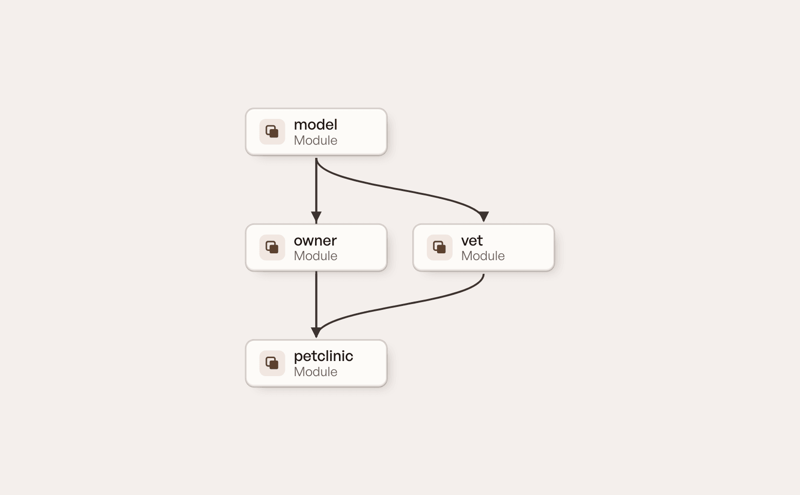
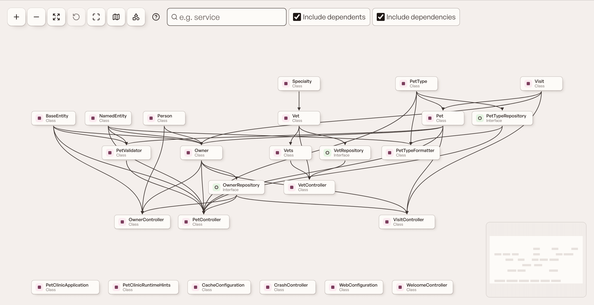
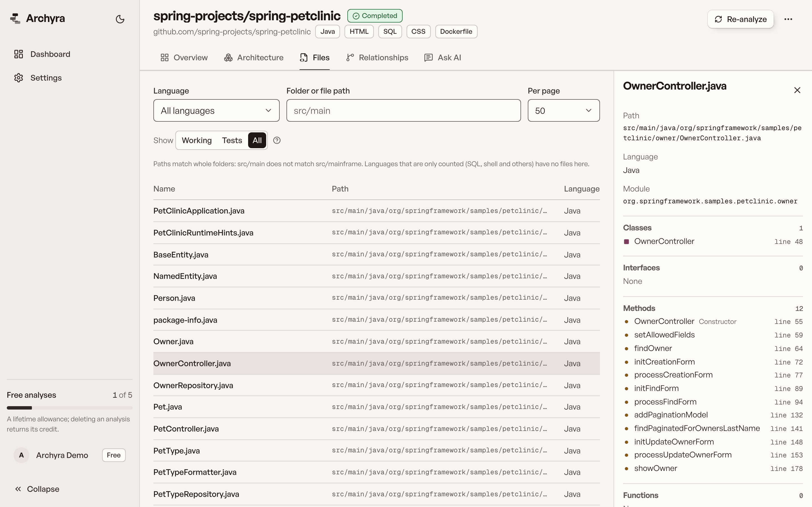
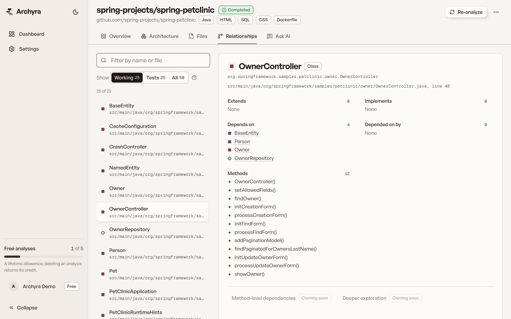
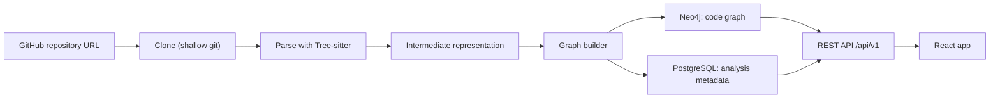
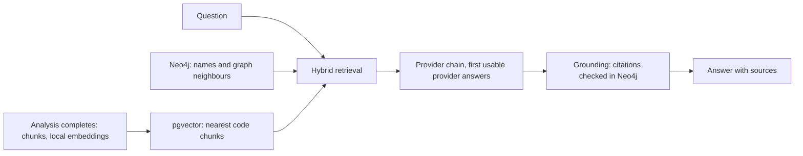

# Archyra

*The architecture behind your code.*


## What is it

Paste the URL of a public GitHub repository. Archyra clones it, parses it with Tree-sitter, builds a code graph in Neo4j
(modules, files, classes, methods and how they import, call, extend and depend on each other) and shows it as an
explorable architecture diagram. You can then ask questions about the repository and get answers that cite the
code they came from.

The graph comes first and works without any AI. Ask AI sits on top of it: the graph says what exists and how it is connected, and the
model explains what that means. There is no hosted instance yet; you run it yourself (see [Quick start](#quick-start)).

<p align="center">
  
</p>

<p align="center">
  
  
</p>
<p align="center">
  
  
</p>

<sub>Screenshots are captured from the running app on <a href="https://github.com/spring-projects/spring-petclinic">spring-petclinic</a>.</sub>

## Features

Built and working today:

- **Repository analysis.** Asynchronous, with live progress. History of your analyses, delete, and re-analyse (the new run replaces the old one when it completes).
- **Languages.** Classes, functions, imports and calls are extracted for Java, Kotlin, Python, JavaScript/TypeScript (JSX/TSX), Go, Rust, C#, PHP, Ruby, Solidity, Vue and Svelte components, and Jupyter notebooks.
  Swift, Dart, C, C++, Scala, R, Julia, shell, SQL, HCL, Dockerfile, HTML and CSS are detected and counted but add no graph nodes.
- **Architecture graph.** Opens on modules joined by *Depends on* (on classes for a single-package repository), with foundations on top. Switch on classes, interfaces, methods, files and the other relationship types; scope control (working code, tests or all); a name filter that also shows dependents and dependencies; draggable nodes; minimap; full screen; the selection and filters live in the URL, so views are deep-linkable.
- **Files and Relationships browsers.** Files with a detail drawer; classes and interfaces with what they extend, implement, depend on and are depended on by.
- **Detected languages and technologies** on the Overview (best effort, from manifests, files and imports).
- **Ask AI.** Questions about a repository answered from its code, with numbered source citations that the server checks against the graph. Conversations are saved. Answers come from a configurable chain of free LLM providers (Gemini first); embeddings run locally, with no key. Free users get 15 questions per week by default, resetting every Monday.
- **Accounts.** Email and password, Google and GitHub sign-in, email verification and password reset, linking and unlinking Google/GitHub in Settings, and account deletion. An admin area lists users and shows statistics.
- **Free and Premium plans.** Free users have a lifetime allowance of analyses and the weekly Ask AI allowance. Premium (through Razorpay, one-time or auto-renew) removes those caps. Payments work only when you configure Razorpay keys; without them the app starts and billing is off.
- **Light and dark themes** (Light, Dark or System).

### Roadmap (not built yet)

- Interactive graph for Premium: click a class to expand into its methods and their calls, method-level dependencies, deeper relationship exploration (V2). The UI shows these as "coming soon".
- Graph views by expertise level, Beginner, Intermediate and Expert (V3).
- AI architecture interpretation (`/architecture`) and "explain this node" (`/explain`).
- Deployment. Packaging the Tree-sitter libraries for deployment, and database migrations (the schema is created by Hibernate `ddl-auto=update` today), are still to do.
- Redis and RabbitMQ for background processing, once there is real load.

## How it works



Ask AI reads the same graph. When an analysis completes, its code is cut into chunks (while the clone still exists), embedded
inside the JVM and stored in pgvector. A question is answered by hybrid retrieval and a chat model:



## Tech stack

| Area | Technology |
| --- | --- |
| Backend | Java 25, Spring Boot 4.0.9, Spring Security (JWT, OAuth2), Spring Data JPA, Maven wrapper |
| Frontend | React 19.3, TypeScript 5.9, Vite 7.3, Tailwind CSS 4.3, React Router 7, TanStack Query 5 |
| Graph UI | React Flow (`@xyflow/react` 12), dagre layout in a Web Worker |
| Data stores | Neo4j (the code graph, via Cypher), PostgreSQL 17 with pgvector (accounts, metadata, embeddings) |
| Parsing | Tree-sitter through `io.github.tree-sitter:jtreesitter` 0.27.0 (Java FFM API) |
| AI | Spring AI 2.0.2 (local ONNX `all-MiniLM-L6-v2` embeddings, Gemini adapter), OpenAI-compatible providers over `RestClient` |
| Payments | Razorpay, through a plain `RestClient` |
| Testing | JUnit 5, Mockito, Testcontainers, WireMock, GreenMail; Vitest, Testing Library, Playwright |

## Quick start

You need:

- Java 25, `git`, `make` and a C compiler (for the Tree-sitter libraries)
- Node.js 22 or newer (`frontend/package.json` declares it in `engines`)
- PostgreSQL 17 **with pgvector** and Neo4j 5, for example through Docker
- A Google and a GitHub OAuth app: the backend does not start without their client ids and secrets
- Optional: an API key for at least one LLM provider, for Ask AI

There is no `docker-compose` file in the repository; the commands below start the two databases by hand.

```bash
# 1. Backend, from backend/
cd backend
./scripts/build-native.sh              # once: builds the Tree-sitter libraries into native/
docker run -d -p 7687:7687 -e NEO4J_AUTH=neo4j/<password> neo4j:5.26-community
docker run -d -p 5432:5432 -e POSTGRES_PASSWORD=<password> -e POSTGRES_DB=archyra pgvector/pgvector:pg17
./scripts/fetch-embedding-model.sh     # optional prefetch of the ~90 MB embedding model
cp .env.example .env                   # then fill in the required values (below)
./mvnw spring-boot:run                 # API on http://localhost:8080

# 2. Frontend, from frontend/ in a second terminal
cd frontend
npm install
npm run dev                            # app on http://localhost:5173
```

Open **http://localhost:5173** (not `127.0.0.1`: the OAuth redirect URIs are registered for that origin), sign in, paste a repository URL on the dashboard and wait for the analysis to finish.

- Register the redirect URIs `http://localhost:5173/login/oauth2/code/google` and `.../github` with the providers.
- For local development over plain HTTP set `COOKIE_SECURE=false` in `.env`.
- The embedding model is downloaded on first start if you skipped `fetch-embedding-model.sh` (it needs access to huggingface.co).
- Email verification and password reset send mail. Point `SMTP_*` at a local sink such as MailHog, or sign in with Google or GitHub.
- Ask AI answers `503 AI_UNAVAILABLE` until at least one provider key is set; indexing and the graph need none.

<details>
<summary>Provider set-up, mail sink and troubleshooting</summary>

Everything is explained in [`backend/README.md`](backend/README.md): OAuth redirect URIs and `redirect_uri_mismatch`, a MailHog
command, the list of LLM providers (keys, models, limits and data-use notes), the Razorpay dashboard set-up, and deployment notes.
A plain `postgres` image stops startup with a message, because Ask AI needs the pgvector extension.

</details>

## Configuration

Settings come from environment variables or `backend/.env`, which is git-ignored (`.env` files are never committed; only `backend/.env.example`
and `frontend/.env.example` are). Variable names only:

| Variable | Purpose |
| --- | --- |
| `DB_USERNAME`, `DB_PASSWORD` | PostgreSQL login (required) |
| `NEO4J_PASSWORD` | Neo4j password (required); `NEO4J_URI`, `NEO4J_USERNAME` optional |
| `JWT_SECRET` | Signs access tokens (required) |
| `GOOGLE_CLIENT_ID`, `GOOGLE_CLIENT_SECRET`, `GITHUB_CLIENT_ID`, `GITHUB_CLIENT_SECRET` | OAuth login (required to start) |
| `ANALYSIS_LIMIT` | Lifetime analyses for Free users (required) |
| `USAGE_LEDGER_SECRET` | Key for the usage ledger that survives account deletion (required) |
| `AI_LIMIT`, `USAGE_RESET_ZONE` | Weekly Ask AI allowance and the time zone of its Monday reset |

<details>
<summary>All other variables</summary>

| Variable | Purpose |
| --- | --- |
| `JWT_ISSUER`, `COOKIE_SECURE`, `FRONTEND_BASE_URL`, `CORS_ALLOWED_ORIGINS` | Token issuer, cookie flag, and the SPA origin for links and CORS |
| `AI_PROVIDER_ORDER` | Order in which Ask AI providers are tried |
| `GEMINI_API_KEY`, `GROQ_API_KEY`, `OPENROUTER_API_KEY`, `CLOUDFLARE_API_TOKEN`, `CLOUDFLARE_ACCOUNT_ID`, `ZAI_API_KEY`, `COHERE_API_KEY`, `LLM7_API_KEY` | Keys of the standard providers |
| `GEMINI_MODEL`, `GROQ_MODEL`, `OPENROUTER_MODEL` | Model overrides |
| `OVH_ENABLED` | OVHcloud works without a key and is on by default |
| `NVIDIA_NIM_ENABLED`, `NVIDIA_NIM_API_KEY`, `KILO_ENABLED`, `GONKA_ENABLED`, `GONKA_API_KEY` | Opt-in providers, off unless enabled |
| `EMBEDDING_CACHE_DIR` | Where the local embedding model is cached |
| `RAZORPAY_KEY_ID`, `RAZORPAY_KEY_SECRET`, `RAZORPAY_WEBHOOK_SECRET`, `RAZORPAY_PLAN_MONTHLY`, `RAZORPAY_PLAN_YEARLY`, `BILLING_ZONE` | Payments; without the key pair billing is off |
| `SMTP_HOST`, `SMTP_PORT`, `SMTP_USERNAME`, `SMTP_PASSWORD`, `SMTP_AUTH`, `SMTP_STARTTLS`, `MAIL_FROM` | Outgoing mail |
| `ADMIN_EMAIL`, `ADMIN_PASSWORD` | Creates the first administrator if none exists |

The frontend has one variable, `VITE_BACKEND_ORIGIN` (the dev proxy target, default `http://localhost:8080`). Never put a secret in a `VITE_*` variable.

</details>

Details and the meaning of each value: [`backend/README.md`](backend/README.md) → Configuration.

## Project structure

```
backend/          Spring Boot API and analysis engine (package-by-feature under com.abhiraj.archyra)
frontend/         React app, talking to the real /api/v1 backend through the Vite proxy
  src/assets/     screenshots captured from the running app (used above)
spec/             feature specs and decisions (some specs live in backend/spec and frontend/spec)
Architecture.md   design source of truth: roadmap, API contracts, data model, decisions
CLAUDE.md         working guide for the codebase (also backend/CLAUDE.md and frontend/CLAUDE.md)
```

## Documentation

- [`Architecture.md`](Architecture.md): design, API contracts and the decision log
- [`backend/README.md`](backend/README.md): running, configuring and securing the backend, Ask AI providers, payments
- [`backend/CLAUDE.md`](backend/CLAUDE.md) and [`frontend/CLAUDE.md`](frontend/CLAUDE.md): conventions, rules and structure of each side
- [`frontend/DESIGN-NOTES.md`](frontend/DESIGN-NOTES.md): design tokens, graph layout and the dark theme
- [`spec/`](spec/): specs for individual features

## Testing

```bash
cd backend  && ./mvnw clean test      # all backend tests; Docker must be running (PostgreSQL with pgvector and Neo4j start through Testcontainers)
cd frontend && npm run verify         # typecheck, lint, token checks, unit tests, build and the session-boot e2e test
cd frontend && npm run e2e            # Playwright against the running stack; skips without test credentials in .env.local
```

The first backend run downloads the embedding model (about 90 MB). The Playwright tests need a running backend and frontend and a
dedicated test account; see [`frontend/CLAUDE.md`](frontend/CLAUDE.md).

## Contributing

There is no contributing guide yet. If you want to change something, open an issue first, and read the `CLAUDE.md` files for the
conventions (no mock data, package-by-feature on the backend, design tokens only on the frontend). Add or update tests with your change.

## Licence

Archyra is licensed under the MIT License. See [`LICENSE`](LICENSE).
